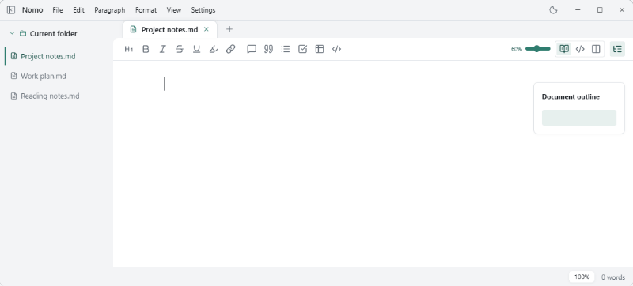

<p align="center">
  
</p>

<h1 align="center">Nomor</h1>

<p align="center">
  <a href="https://github.com/whitelunatix/nomor/releases/latest">
    
  </a>
  
  <a href="./LICENSE">
    
  </a>
</p>

<p align="center">
  <a href="./README.md">简体中文</a>
  ·
  <a href="./README.en.md"><strong>English</strong></a>
</p>

<p align="center">
  <strong>A local-first Markdown editor that keeps writing simple.</strong>
</p>

<p align="center">
  
</p>

> **About this project**: Nomor is a derivative of [Nomo](https://github.com/nomo-md/nomo) by LIXianSenQwQ, released under the same AGPL-3.0-or-later license. It adds `.docx.md` Word document editing and export, line numbers for the source and rendered panes, and other features; all source is published as required by the AGPL.

## Download

Get the latest version from [GitHub Releases](https://github.com/whitelunatix/nomor/releases/latest).

| OS | Requirement | Installer |
| :--- | :--- | :--- |
| Windows | Windows 10 / 11, x64 | `.exe` installer / portable `.zip` |
| macOS | macOS 12.0+, Apple Silicon | `.dmg` |

This derivative does not publish a Homebrew cask yet; use the installers from the release page.

SmartScreen / Gatekeeper may warn on first launch; make sure you downloaded from this project's Releases.

## Features

- **Markdown editing**: live preview, source and split modes, `/` quick insert.
- **Word documents**: edit `.docx.md` files with Word directive lines for fonts, paragraphs, page breaks and page setup, then export an editable `.docx`.
- **Rich content**: tables, syntax highlighting, math and Mermaid diagrams.
- **File management**: type-to-find file tree, multiple tabs, segmented editing for large TXT / JSON files.
- **Save and restore**: optional autosave and local Markdown snapshots, restore workspace and reading position.
- **Comfortable writing**: light and dark themes, [custom color themes and fonts](docs/custom-themes.md), optional fine typography, and a pinnable Markdown mini window.
- **Export and preview**: export to HTML / PDF / Word; Word body text and tables stay editable, math and diagrams become images; Quick Look on macOS.
- **Line numbers**: turn on source and rendered line numbers separately in settings; both panes share the same "effective line" numbering.

See [release notes](https://github.com/whitelunatix/nomor/releases) for version changes.

## Development

Built with Tauri 2 + Svelte 5. Requires Node.js 22, pnpm 11.5.1 and Rust / Cargo.

- Windows: Visual Studio 2022 Build Tools or a full Visual Studio install.
- macOS: Xcode Command Line Tools; the Quick Look extension needs a full Xcode install.

```bash
pnpm install
pnpm tauri dev
```

## Contributing

[Issues](https://github.com/whitelunatix/nomor/issues) and [pull requests](https://github.com/whitelunatix/nomor/pulls) are welcome; include your OS version, steps to reproduce and a sample when reporting a bug.

Enjoy Nomor? [Star the project](https://github.com/whitelunatix/nomor). Upstream [Nomo](https://github.com/nomo-md/nomo) is developed by [LIXianSenQwQ](https://github.com/LIXianSenQwQ).

Licensed under [AGPL-3.0-or-later](./LICENSE); third-party components keep their own licenses.

Thanks to Tauri, Svelte, ProseMirror, CodeMirror, markdown-it, Shiki, KaTeX, Mermaid and other open-source projects.
