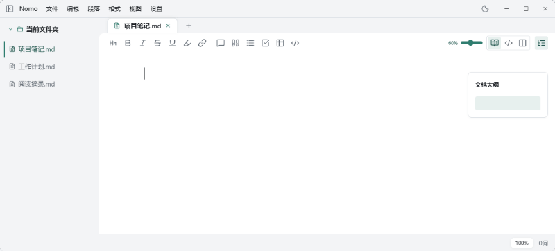

<p align="center">
  
</p>

<h1 align="center">Nomor</h1>

<p align="center">
  <a href="https://github.com/whitelunatix/nomor/releases/latest">
    
  </a>
  
  <a href="./LICENSE">
    
  </a>
</p>

<p align="center">
  <a href="./README.md"><strong>简体中文</strong></a>
  ·
  <a href="./README.en.md">English</a>
</p>

<p align="center">
  <strong>一款本地优先的 Markdown 编辑器，让写作保持简单。</strong>
</p>

<p align="center">
  
</p>

> **关于本项目**：Nomor 是 [Nomo](https://github.com/nomo-md/nomo)（作者 LIXianSenQwQ）的派生版本，遵循同一份 AGPL-3.0-or-later 许可证。在原项目基础上增加了 `.docx.md` Word 文档编辑与导出、源码区与渲染区行号等能力，并按 AGPL 要求公开全部源码。

## 下载与安装

从 [GitHub Releases](https://github.com/whitelunatix/nomor/releases/latest) 下载最新版本。

| 系统 | 要求 | 安装方式 |
| :--- | :--- | :--- |
| Windows | Windows 10 / 11，x64 | `.exe` 安装版 / `.zip` 免安装版 |
| macOS | macOS 12.0+，Apple Silicon | `.dmg` |

本派生项目暂未发布 Homebrew cask，请直接使用发布页的安装包。

首次打开可能出现 SmartScreen / Gatekeeper 提示，请从本项目 Releases 下载。

## 核心功能

- **Markdown 编辑**：即时预览、源码与双栏模式，输入 `/` 快速插入内容。
- **Word 文档**：`.docx.md` 双向编辑，可叠加 Word 指令行控制字体、段落、分页与页面设置，并导出可编辑的 `.docx`。
- **丰富内容**：支持表格、代码高亮、数学公式与 Mermaid 图表。
- **文件管理**：文件树键入定位、多标签，以及 TXT / JSON 大文件分段编辑。
- **保存与恢复**：可启用自动保存和 Markdown 本地快照，恢复工作区与阅读位置。
- **舒适写作**：浅深色主题、[自定义配色主题与字体](docs/custom-themes.md)、可手动开启的精细排版，以及可置顶的 Markdown 小窗。
- **导出与预览**：导出 HTML / PDF / Word（.docx），Word 正文和表格可编辑，公式与图表转为图片；macOS 支持 Quick Look 快速预览。
- **行号**：可在设置中分别开启源码模式与渲染模式的行号，两侧按同一套「有效行」编号对齐。

版本变化请查看[更新记录](https://github.com/whitelunatix/nomor/releases)。

## 开发

使用 Tauri 2 + Svelte 5 构建，需要 Node.js 22、pnpm 11.5.1 和 Rust / Cargo。

- Windows：Visual Studio 2022 Build Tools 或完整 Visual Studio。
- macOS：Xcode Command Line Tools；构建 Quick Look 扩展需要完整 Xcode。

```bash
pnpm install
pnpm tauri dev
```

## 参与项目

欢迎提交 [Issue](https://github.com/whitelunatix/nomor/issues) 或 [Pull Request](https://github.com/whitelunatix/nomor/pulls)；反馈问题时请附系统版本、复现步骤与样例。

喜欢 Nomor，欢迎 [Star 项目](https://github.com/whitelunatix/nomor)。上游 [Nomo](https://github.com/nomo-md/nomo) 由 [LIXianSenQwQ](https://github.com/LIXianSenQwQ) 开发。

采用 [AGPL-3.0-or-later](./LICENSE) 许可证；商业授权请联系维护者，第三方组件遵循各自许可证。

感谢 Tauri、Svelte、ProseMirror、CodeMirror、markdown-it、Shiki、KaTeX、Mermaid 等开源项目。
